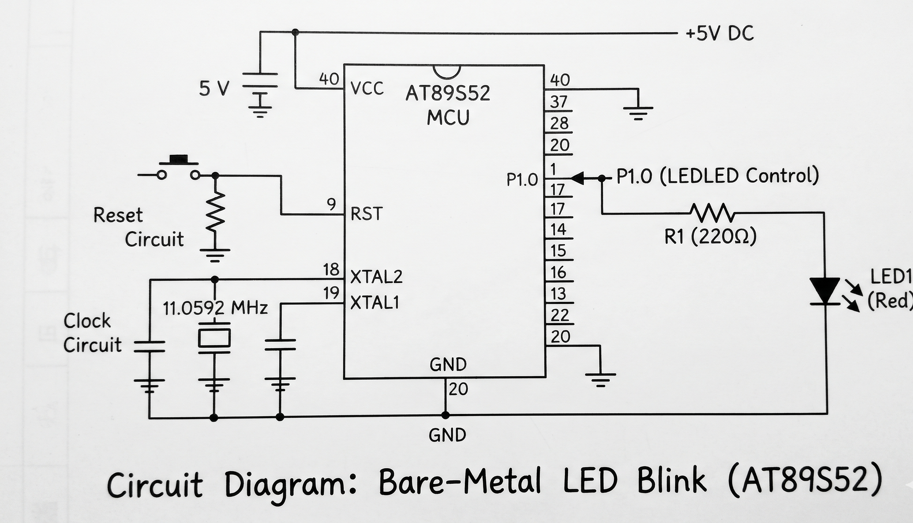

# EXPERIMENT DETAILS
EXP: CONTINUOUS ASSESSMENT 2
DATE: 20/07/2026
NAME OF EXP: 8051 Tool Chain Setup & Bare-Metal LED Blink
HARDWARE SETUP / PLATFORM: AT89S52 Microcontroller Development Board, Keil C51, LED, 220Ω Resistor

## 1. Circuit Diagram

## 2. Core Logic / Pseudocode / Code Base
**Working Principle:**
The LED is connected to pin P1.0 of the AT89S52 microcontroller. The program directly accesses hardware registers to switch the pin state, introducing a time delay via nested software loops to control the blinking frequency.

**Code Base:**

#include <reg52.h>

sbit LED = P1^0;

void delay_ms(unsigned int ms) {
    unsigned int i, j;
    for (i = 0; i < ms; i++) {
        for (j = 0; j < 120; j++);
    }
}

void main(void) {
    while (1) {
        LED = 0;            // Turn LED ON
        delay_ms(500);      // Delay ~500ms
        LED = 1;            // Turn LED OFF
        delay_ms(500);      // Delay ~500ms
    }
}
3. Inference

The LED connected to P1.0 blinks continuously as the microcontroller alternates output states. This demonstrates direct register-level GPIO configuration, software delay generation, and embedded C programming on the 8051 architecture using Keil C51.