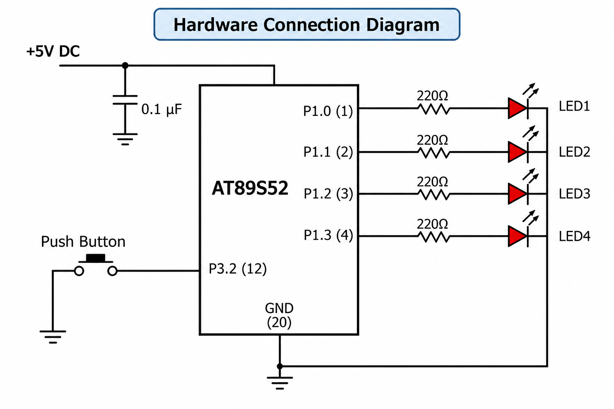

# Task 3A: LED Operating Modes and Pattern Control

## 📋 Objective
To design and implement an Embedded C program for the AT89S52 microcontroller to drive multiple LEDs through various configurable switching modes and patterns.

## 🛠️ Hardware & Pin Configuration
* **Microcontroller:** AT89S52 (11.0592 MHz Crystal)[cite: 13]
* **Output Peripherals:** LED array connected to Port lines (e.g., Port 1 or Port 2).
* **Control Input:** Push-button switches for mode selection.

## 🚀 Implementation Details
* Implements state-machine logic to cycle through different LED blinking patterns (e.g., sequential, alternating, flashing).
* Utilizes software delay routines for timing adjustments between state transitions.

## 📷 Circuit Schematic
