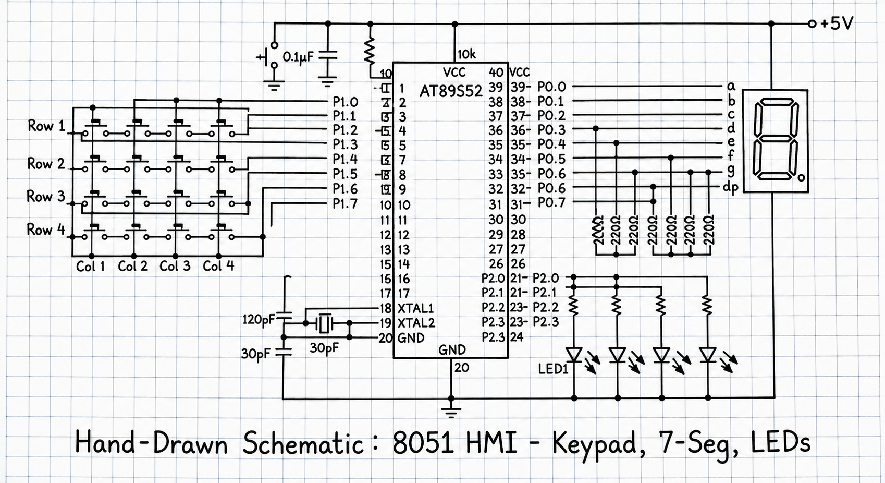

# Task 4A: Matrix and 7-Segment Display Interfacing

## 📋 Objective
To develop an Embedded C application for the AT89S52 microcontroller to interface and control a 7-segment display or matrix configuration, displaying sequential numeric/alphanumeric digits.

## 🛠️ Hardware & Pin Configuration
* **Microcontroller:** AT89S52 (11.0592 MHz Crystal)[cite: 13]
* **Display Output:** 7-Segment LED display driven via port pins or multiplexing transistors.
* **Current-Limiting Resistors:** Connected in series with segment pins to protect LEDs.

## 🚀 Implementation Details
* Uses a segment lookup table (hex code array for digits 0–9) to drive cathode/anode segments.
* Implements multiplexing control or direct port writing to refresh digits dynamically.

## 📷 Circuit Schematic
