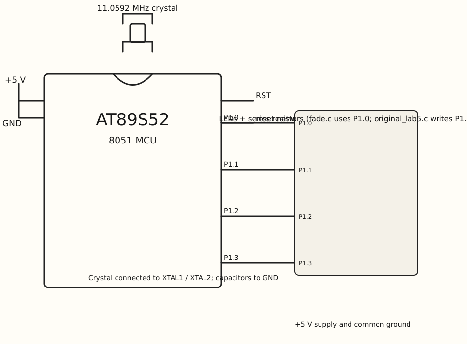

EXPERIMENT DETAILS
EXP: Continuous Lab Evaluation-5
DATE: 10/08/2026
NAME OF EXP: Hardware Timer and Interrupt-Based Timing for LED Fading, Pulse Generation, and Stepper Motor Control
HARDWARE SETUP / PLATFORM: AT89S52 8051 development board + Keil C51
TASK 1 : LED fading using software PWM

1. Circuit Diagram

fade.c updates P1.0 from a Timer 0 ISR.

* Microcontroller: AT89S52 (8051)
* GPIO Port: Port 1; Timer 0 is also used
* GPIO Pin: P1.0
* Peripheral: LED(s) with series resistors
* Power Supply: +5 V DC development-board supply.

2. Core Logic / Pseudocode / Code Base

Working Principle:
fade.c sets Timer 0 mode 1 and enables its ISR. The ISR reloads TH0/TL0, updates tick/ms/duty, and assigns a Boolean comparison to P1.0.

Pseudocode:
1. Configure Timer 0, enable ET0 and EA, and start it.
2. On each interrupt reload the timer and update tick.
3. Advance or decrease duty after the ms count threshold.
4. Set P1.0 from the tick-versus-duty comparison.

Code Base:

Source file included and read in this task: `fade.c`.

* fade.c includes reg51.h for the 8051 port and timer declarations.
* led maps to P1.0; timer0() is interrupt 1 and reloads TH0=0xFC, TL0=0x66.
* TMOD=0x01, ET0=1, EA=1, and TR0=1 configure and start Timer 0 interrupts.
* tick, ms, duty, and up control the P1.0 assignment.

3. Inference

fade.c switches P1.0 according to its tick and duty counters. The output demonstrates Timer 0 interrupt timing and software PWM-style LED control.
