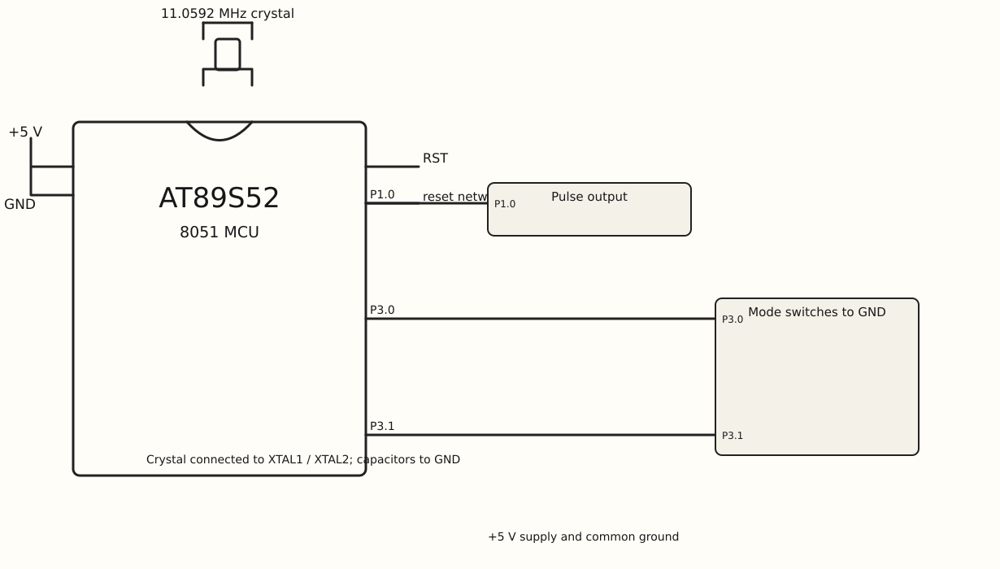

EXPERIMENT DETAILS
EXP: Continuous Lab Evaluation-5
DATE: 10/08/2026
NAME OF EXP: Hardware Timer and Interrupt-Based Timing for LED Fading, Pulse Generation, and Stepper Motor Control
HARDWARE SETUP / PLATFORM: AT89S52 8051 development board + Keil C51
TASK 2 : variable-frequency square-wave generation

1. Circuit Diagram

P1.0 is toggled by a Timer 0 ISR; P3.0 and P3.1 select the tick limit.

* Microcontroller: AT89S52 (8051)
* GPIO Port: Ports 1 and 3; Timer 0 is also used
* GPIO Pin: P1.0; P3.0 and P3.1
* Peripheral: square-wave output and two mode input contacts
* Power Supply: +5 V DC development-board supply.

2. Core Logic / Pseudocode / Code Base

Working Principle:
main() configures Timer 0 mode 1 and enables interrupts. The main loop selects limit 10, 2, or 50 from the P3 inputs. The ISR reloads TH0/TL0, counts ticks, and toggles P1.0 at the selected limit.

Pseudocode:
1. Set TMOD, TH0, and TL0 for Timer 0.
2. Enable ET0 and EA and start TR0.
3. Poll P3.0 then P3.1 to select limit.
4. On each timer interrupt reload the timer and increase ticks.
5. Toggle P1.0 and reset ticks when ticks reaches limit.

Code Base:

Source files included and read in this task: `square_wave.c`.

* reg51.h supplies the timer and P3_0/P3_1 names.
* pulse is assigned to P1.0.
* timer0() interrupt 1 reloads TH0=0xFC and TL0=0x66.
* TMOD=0x01, ET0=1, EA=1, TR0=1 configure and start Timer 0 interrupts.
* The main loop sets limit to 10, 2, or 50; P3.0 has priority over P3.1.
* The ISR toggles pulse when ticks reaches limit.

3. Inference

P1.0 produces a repeating high/low signal. The two P3 input levels change the number of timer interrupts between toggles. This demonstrates timer interrupt output toggling; no frequency display or measurement is coded.
