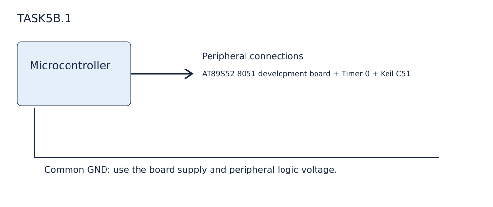

EXPERIMENT DETAILS
EXP: CONTINUOUS ASSESMENT 5
DATE: 10/08/2026
NAME OF EXP: Hardware Timer and Interrupt-Based Timing for LED Fading, Pulse Generation, and Stepper Motor Control
HARDWARE SETUP / PLATFORM: AT89S52 8051 development board + Timer 0 + Keil C51
TASK 5B.1 : Variable-frequency square-wave generation

1. Circuit Diagram
P1.0 connects to the oscilloscope input. Use common ground. P3.0 and P3.1 select the toggle interval.

2. Core Logic / Pseudocode / Code Base
Working Principle: Timer 0 reloads FC66 and counts interrupts; P3.0 and P3.1 select limits 10, 2 or 50. The ISR toggles P1.0 at the selected limit. These existing limits do not implement the full 100 Hz to 5 kHz range listed in the paper.
Pseudocode:
1. Configure Timer 0 in mode 1; enable ET0 and EA, and start TR0.
2. Reload TH0/TL0 on interrupt 1.
3. Count ticks to the selected limit and toggle pulse.
Code Base: square_wave.c declares pulse as P1^0 and defines timer0() interrupt 1. STARTUP.A51 and TaskSource.uvproj retain the original filenames.

3. Inference
Timer 0 reloads FC66 and counts interrupts; P3.0 and P3.1 select limits 10, 2 or 50. The ISR toggles P1.0 at the selected limit. These existing limits do not implement the full 100 Hz to 5 kHz range listed in the paper. The retained Objects hex belongs to the existing project.
