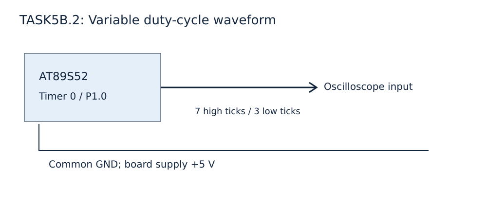

EXPERIMENT DETAILS
EXP: CONTINUOUS ASSESMENT 5
DATE: 10/08/2026
NAME OF EXP: Hardware Timer and Interrupt-Based Timing for LED Fading, Pulse Generation, and Stepper Motor Control
HARDWARE SETUP / PLATFORM: AT89S52 8051 development board + Timer 0 + Keil C51
TASK 5B.2 : Variable duty-cycle waveform

1. Circuit Diagram
P1.0 connects to the oscilloscope input. Use common ground. The waveform uses a fixed ten-tick period.

2. Core Logic / Pseudocode / Code Base
Working Principle: Timer 0 reloads FC66. A ten-tick period drives P1.0 high for seven ticks and low for three, producing a 70 percent duty waveform.
Pseudocode:
1. Configure Timer 0 in mode 1; enable ET0 and EA, and start TR0.
2. Reload TH0/TL0 on interrupt 1.
3. Advance tick modulo ten and assign the pulse output.
Code Base: square_wave.c declares pulse as P1^0 and defines timer0() interrupt 1. STARTUP.A51 and TaskSource.uvproj retain the original filenames.

3. Inference
Timer 0 reloads FC66. A ten-tick period drives P1.0 high for seven ticks and low for three, producing a 70 percent duty waveform. The source is newly created and requires a Keil C51 build; no hex was fabricated.
