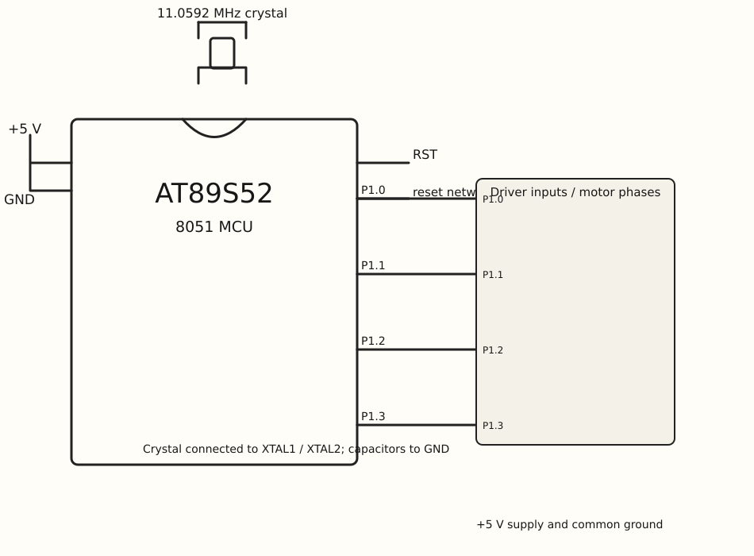

EXPERIMENT DETAILS
EXP: CONTINUOUS ASSESMENT 5
DATE: 10/08/2026
NAME OF EXP: Hardware Timer and Interrupt-Based Timing for LED Fading, Pulse Generation, and Stepper Motor Control
HARDWARE SETUP / PLATFORM: AT89S52 8051 development board + Keil C51
TASK 5C : Stepper-motor speed and direction control. (*)

1. Circuit Diagram

The P1 low nibble is written with four one-bit phase values from the sequence array.

* Microcontroller: AT89S52 (8051)
* GPIO Port: Port 1; Timer 0 is also used
* GPIO Pin: P1.0–P1.3
* Peripheral: four phase-input lines to a stepper interface; the source does not specify a driver IC
* Power Supply: +5 V DC development-board supply.

2. Core Logic / Pseudocode / Code Base

Working Principle:
main() starts Timer 0 mode 1 with its interrupt enabled. The ISR reloads TH0/TL0; after 50 counts it writes seq[step] to P1 and advances step modulo four.

Pseudocode:
1. Configure and start Timer 0 with interrupts enabled.
2. On timer interrupt reload TH0/TL0 and increment ticks.
3. When ticks reaches 50, clear ticks.
4. Write the next seq value to P1 and advance step modulo four.
5. Leave the main loop running.

Code Base:

Source files included and read in this task: `stepper.c`.

* reg51.h provides the 8051 timer and port declarations.
* seq contains 0x08, 0x04, 0x02, 0x01, selecting P1.3 through P1.0 in order.
* timer0() interrupt 1 reloads TH0=0xFC and TL0=0x66 and updates ticks.
* TMOD=0x01, ET0=1, EA=1, TR0=1 configure and start Timer 0 interrupts.
* The source does not define a direction input or a motor-driver IC.

3. Inference

P1.3, P1.2, P1.1, and P1.0 are asserted in sequence, one at a time. The code demonstrates periodic port updates from a timer interrupt; it does not implement a direction control input.
