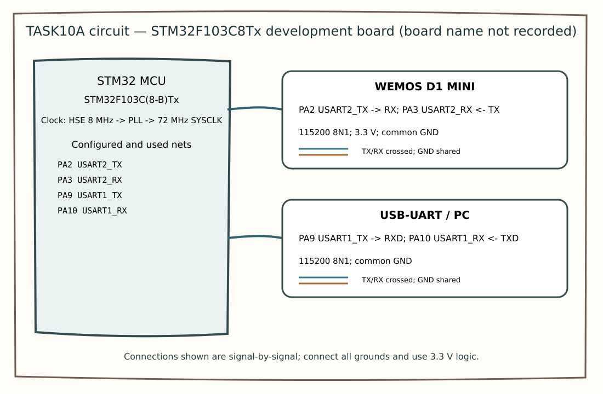

EXPERIMENT DETAILS
EXP: CONTINUOUS ASSESMENT 10
DATE: 05/10/2026
NAME OF EXP: STM32-Wemos Wi-Fi Modem Interface Using AT Commands
HARDWARE SETUP / PLATFORM: custom board + STM32F103C(8-B)Tx + USART2 PA2 TX / PA3 RX to Wemos; USART1 PA9 TX / PA10 RX to PC; 115200 8N1 + STM32CubeMX (MDK-ARM project)
TASK 10A : Establish STM32 <-> Wemos UART Communication

1. Circuit Diagram
The diagram shows the task pins, clock source and required external connections.
* Microcontroller / Board: STM32F103C8Tx board (board name not recorded); MCU STM32F103C(8-B)Tx.
* GPIO / Peripheral pins: USART2 PA2 TX / PA3 RX to Wemos; USART1 PA9 TX / PA10 RX to PC; 115200 8N1.
* Clock: HSE through PLL, 72 MHz SYSCLK.
* External components: Wemos D1 mini (UART crossed) and USB-UART terminal, common ground, 3.3 V.
* Power Supply: 3.3 V logic supply and common GND.

2. Core Logic / Pseudocode / Code Base
Working Principle: The STM32 sends AT through USART2 and forwards the modem response through USART1.
Pseudocode:
1. Send AT to the modem on USART2.
2. Forward modem response bytes to USART1.
Code Base: Embedded C using STM32 HAL (STM32CubeMX)
* HAL_UART_Transmit sends AT command bytes.
* HAL_UART_Receive reads modem response bytes.

3. Inference
The STM32 sends AT through USART2 and forwards the modem response through USART1. The experiment demonstrates UART modem control using ESP8266 AT commands.
