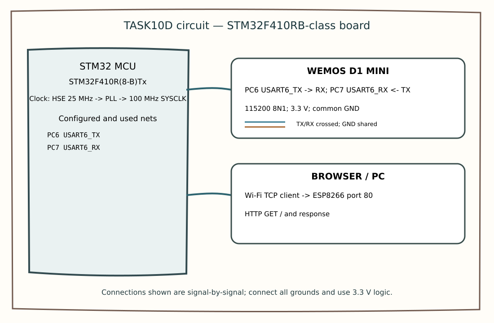

EXPERIMENT DETAILS
EXP: CONTINUOUS ASSESMENT 10C
DATE: 05/10/2026
NAME OF EXP: HTTP Server - STM32-Wemos Wi-Fi Modem Using AT Commands
HARDWARE SETUP / PLATFORM: custom board + STM32F410R(8-B)Tx + USART6 PC6 TX / PC7 RX to Wemos; 115200 8N1 + STM32CubeMX (MDK-ARM project)
TASK 10D : Configure ESP8266 as a TCP Server; Observe the HTTP Request / construct static HTTP response

1. Circuit Diagram
The diagram shows the task pins, clock source and required external connections.
* Microcontroller / Board: custom board; MCU STM32F410R(8-B)Tx.
* GPIO / Peripheral pins: USART6 PC6 TX / PC7 RX to Wemos; 115200 8N1.
* Clock: HSE through PLL, 100 MHz SYSCLK.
* External components: Wemos D1 mini (UART crossed), Wi-Fi browser client, common ground, 3.3 V.
* Power Supply: 3.3 V logic supply and common GND.

2. Core Logic / Pseudocode / Code Base
Working Principle: The ESP8266 joins Wi-Fi and listens as a TCP server on port 80. When a browser GET request arrives in an +IPD frame, the STM32 builds an HTTP response, sends it with CIPSEND and closes the connection.
Pseudocode:
1. Configure Wi-Fi station and TCP server on port 80.
2. Receive +IPD data and check for GET /.
3. Send the HTTP response using CIPSEND, then close the connection.
Code Base: Embedded C using STM32 HAL (STM32CubeMX)
* ESP_Send transmits AT strings over USART6.
* HAL_UART_Receive reads the +IPD request.
* strstr detects +IPD and GET /.
* snprintf constructs the HTML body, HTTP headers and CIPSEND/CIPCLOSE commands.
* HAL_UART_Transmit sends the HTTP response.

3. Inference
The ESP8266 joins Wi-Fi and listens as a TCP server on port 80. When a browser GET request arrives in an +IPD frame, the STM32 builds an HTTP response, sends it with CIPSEND and closes the connection. The experiment demonstrates UART modem control using ESP8266 AT commands.
