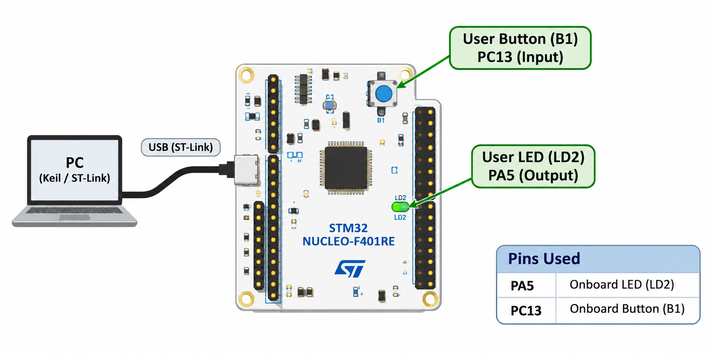

# CAT11 – Task 11A: On-board LED Bring-Up

## EXP
CAT11

## DATE
14/10/2026

## NAME OF EXP
STM32F401RE Cortex-M4: GPIO and User Input Programming

## HARDWARE SETUP / PLATFORM
- STM32 NUCLEO-F401RE
- Onboard LED: LD2 (PA5)
- System clock: 84 MHz

## TASK NO
Task 11A – On-board LED Bring-Up

## Circuit Diagram

## Core Logic / Pseudocode / Code Base
1. Configure PA5 as GPIO output.
2. Initialize the STM32 HAL.
3. Toggle the onboard LED using `HAL_GPIO_TogglePin()`.
4. Introduce a 500 ms delay using `HAL_Delay()`.

Source code: `Core/Src/main.c`

## INFERENCE
Implemented onboard LED blinking using the STM32 NUCLEO-F401RE GPIO output. The LED toggles at a fixed interval. The project compiled successfully using Keil MDK-ARM.