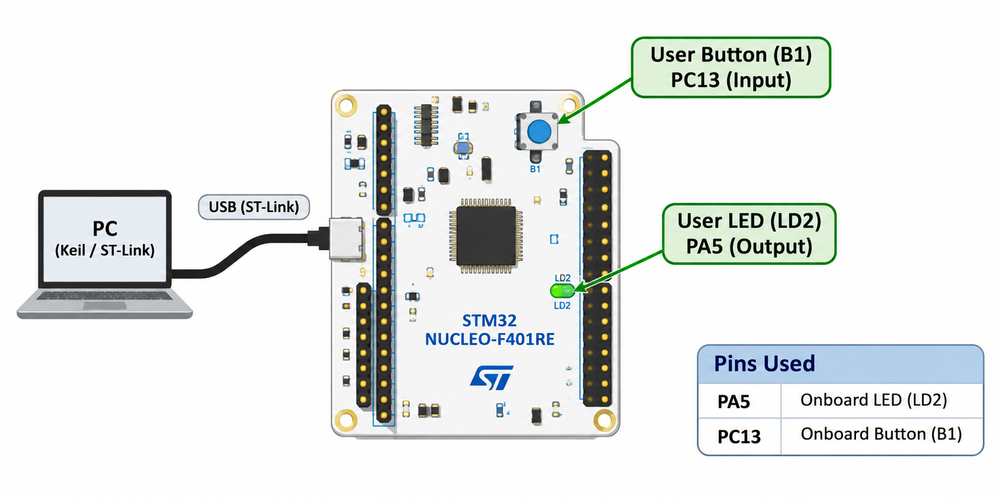

# CAT11 – Task 11B: On-board Switch Control with State Remembrance

## EXP
CAT11

## DATE
14/10/2026

## NAME OF EXP
STM32F401RE Cortex-M4: GPIO and User Input Programming

## HARDWARE SETUP / PLATFORM
- STM32 NUCLEO-F401RE
- Onboard LED: LD2 (PA5)
- Onboard user button: B1 (PC13)

## TASK NO
Task 11B – On-board Switch Control with State Remembrance

## Circuit Diagram

## Core Logic / Pseudocode / Code Base
1. Configure PA5 as GPIO output and PC13 as GPIO input.
2. Continuously read the button state.
3. Apply 30 ms software debouncing.
4. Detect a valid button press.
5. Toggle the onboard LED once per valid press.
6. Retain the LED state after the button is released.

Source code: `Core/Src/main.c`

## INFERENCE
Implemented debounced switch-controlled LED operation using STM32 GPIO. Each valid button press toggles the onboard LED, and the LED retains its state after release.