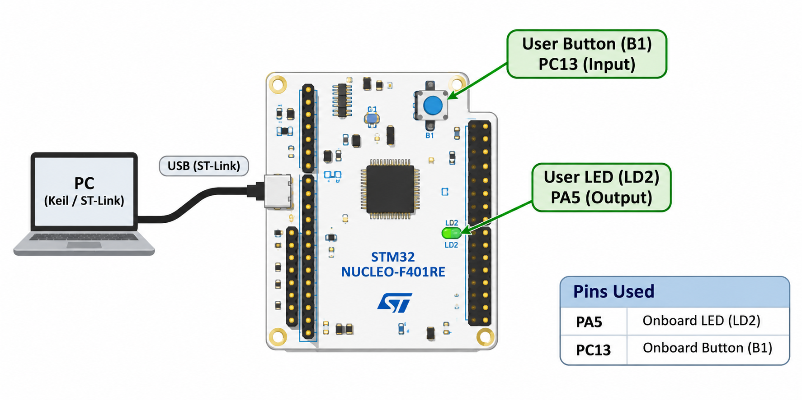

# CAT11 – Task 11C: Short-Press and Long-Press Detection

## EXP
CAT11

## DATE
14/10/2026

## NAME OF EXP
STM32F401RE Cortex-M4: GPIO and User Input Programming

## HARDWARE SETUP / PLATFORM
- STM32 NUCLEO-F401RE
- Onboard LED: LD2 (PA5)
- Onboard user button: B1 (PC13)

## TASK NO
Task 11C – Short-Press and Long-Press Detection

## Circuit Diagram

## Core Logic / Pseudocode / Code Base
1. Configure PA5 as GPIO output and PC13 as GPIO input.
2. Read the onboard button continuously.
3. Apply 30 ms software debouncing.
4. Measure the button press duration.
5. For a short press, toggle the onboard LED.
6. For a long press, enable or disable LED blinking mode.
7. When blinking mode is enabled, toggle the LED every 500 ms.

Source code: `Core/Src/main.c`

## INFERENCE
Implemented short-press and long-press detection using STM32 GPIO and HAL tick timing. Different LED operations are performed according to the duration of the button press.