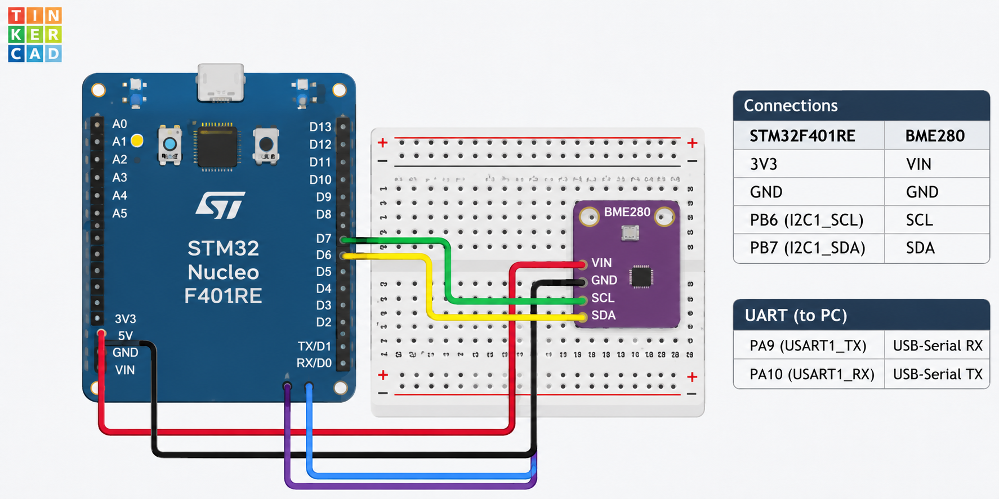

# CAT12 – BME280 Sensor Interfacing Using I²C and Bosch Sensor API

| Field | Details |
|---|---|
| **EXP** | CAT12 |
| **DATE** | __________________ |
| **NAME OF EXP** | BME280 Sensor Interfacing Using I²C and Bosch Sensor API |
| **HARDWARE SETUP / PLATFORM** | STM32 Nucleo-F401RE, BME280 sensor module, Keil µVision, STM32 HAL, Bosch BME280 Sensor API |
| **TASK NO** | CAT12 |

## Circuit Diagram



### Pin Connections

| BME280 | STM32 Nucleo-F401RE | Description |
|---|---|---|
| VCC / VIN | 3.3 V | Power supply |
| GND | GND | Common ground |
| SCL | PB6 | I²C1 clock |
| SDA | PB7 | I²C1 data |
| CSB | 3.3 V | Selects I²C interface |
| SDO | GND | Selects I²C address 0x76 |

**UART connections used for serial output:**

| STM32 pin | Connection |
|---|---|
| PA9 (USART1_TX) | USB-to-UART adapter RX |
| PA10 (USART1_RX) | USB-to-UART adapter TX |
| GND | Adapter GND |

Use a 3.3 V-compatible USB-to-UART adapter. On the usual Nucleo-F401RE configuration, the ST-LINK virtual COM port is not automatically connected to USART1 PA9/PA10.

## Core Logic / Pseudocode / Code Base

### Core Logic

1. Initialize the STM32 HAL library.
2. Configure the system clock.
3. Initialize GPIO, I²C1, and USART1 peripherals.
4. Configure the Bosch BME280 driver interface with I²C read, write, and delay callback functions.
5. Initialize the BME280 sensor. First check I²C address `0x76`; if initialization fails, try `0x77`.
6. Configure temperature, pressure, and humidity oversampling to **×1**.
7. Disable the IIR filter.
8. Set the sensor to **normal mode**.
9. Read compensated temperature, pressure, and humidity measurements.
10. Transmit the readings through USART1 at 115200 baud.
11. Repeat the sensor-reading operation every one second.

### Code Base

The Keil project retains its original STM32 project structure. The main application logic is implemented in:

- `Core/Src/main.c` – HAL initialization, I²C callbacks, BME280 configuration, sensor readings, and UART transmission.
- `Core/Inc/main.h` – main application declarations and HAL header.
- `Core/Src/stm32f4xx_hal_msp.c` – low-level peripheral clock and GPIO initialization.
- `bme280.c` – Bosch BME280 sensor driver implementation.
- `bme280.h` – Bosch BME280 driver interface.
- `bme280_defs.h` – Bosch BME280 definitions.

The BME280 driver communicates through I²C using the STM32 HAL memory read and memory write functions. The Bosch driver performs sensor compensation and provides the temperature, pressure, and humidity values.

**Important:** Keep `HAL_MspInit()`, `HAL_I2C_MspInit()`, and `HAL_UART_MspInit()` in `stm32f4xx_hal_msp.c`. Do not define duplicate MSP functions in `main.c`.

### Sensor Data and Output

The Bosch integer compensation API represents:
- Temperature in 0.01 °C.
- Pressure in Q24.8 Pa.
- Humidity in Q22.10 %RH.

The application converts these values for readable UART output and displays:
- Temperature in °C.
- Pressure in Pa.
- Relative humidity in %RH.

Example serial output (illustrative values):

```text
CAT12 BME280 SENSOR INTERFACING
Initializing sensor...
BME280 initialized successfully!

Temperature: 29.45 C | Pressure: 100850 Pa | Humidity: 65.22 %RH
```

Actual readings depend on the surrounding environmental conditions and the sensor module.

## INFERENCE

The BME280 sensor was interfaced with the STM32F401RE using the I²C communication protocol. The Bosch BME280 Sensor API was used to initialize and configure the sensor, acquire compensated temperature, pressure, and humidity measurements, and transmit the readings through USART1. This experiment demonstrates I²C-based sensor interfacing and serial data communication using STM32 HAL.
