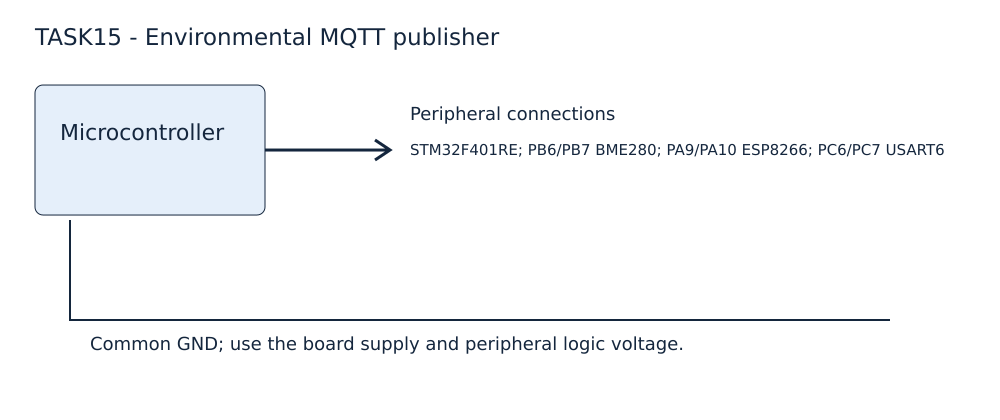

EXPERIMENT DETAILS
EXP: CONTINUOUS ASSESMENT 15
DATE: 27/10/2026 (source MQTT exercise date; a separate CAT15 date was not supplied)
NAME OF EXP: BME280 Environmental MQTT Publisher - Personal Final Project
HARDWARE SETUP / PLATFORM: custom board + STM32F401RE + I2C1 PB6/PB7 BME280; USART1 PA9/PA10 ESP8266; USART6 PC6/PC7 + STM32CubeMX (MDK-ARM project)
TASK 15 : Personal final project for BME280 measurement and MQTT publication

1. Circuit Diagram
Connect BME280 SCL/SDA to PB6/PB7 with 3.3 V pull-ups; ESP8266 RX/TX to PA9/PA10. Use a suitable 3.3 V modem supply and common ground. PC6/PC7 are the configured USART6 pins.

2. Core Logic / Pseudocode / Code Base
Working Principle: The original FINAL_PROJECT_1 application configures the Bosch sensor API and publishes environmental measurements through ESPLib.
Pseudocode:
1. Enable the DWT cycle counter and initialize the configured peripherals.
2. Run BME280_Config with oversampling, filtering and normal measurement mode.
3. Probe the ESP8266 until OK, join Wi-Fi and connect the MQTT client.
4. Read compensated measurements and publish the JSON body once per second.
Code Base: Core/Src/main.c, bme280.c and ESPLib.c. BME280_Read retrieves compensated data. BME280_CreateJSON converts pressure to hPa. BME280_Publish publishes snu/iot/bme280 using MQTT_publishTopic. The project is moved intact from CAT14/FINAL_PROJECT_1 with an added MDK configuration; the original .ioc and MX initialization functions are preserved.

3. Inference
The standalone project retains the personal STM32F401RE application and original source filenames. MDK-ARM targets the F401RE device and includes the application, HAL drivers and an ARMASM startup file. A Keil build and hardware validation are still required. CAT15 has no supplied paper; the date above identifies the source MQTT exercise, not an independently verified CAT15 assessment date.

Application integration: USER CODE enables USART1_IRQn, USART1_IRQHandler dispatches ESP8266_UART_IRQHandler to the UART handle owned by ESPLib, and SysTick calls MQTTTimer for the original ESPLib receive framing. MQTT settings are zero-initialized before use.
