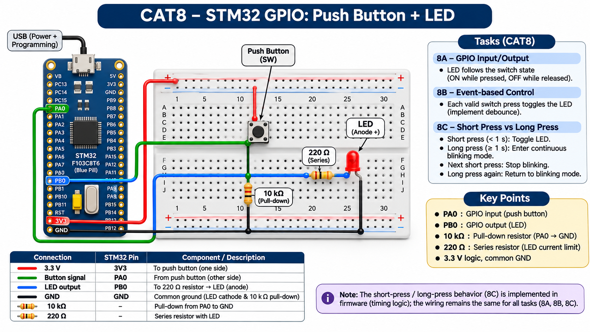

EXPERIMENT DETAILS
EXP: CONTINUOUS ASSESMENT 8
DATE: 18/09/2026
NAME OF EXP: STM32 GPIO Bring-Up and Switch-Controlled LED
HARDWARE SETUP / PLATFORM: custom board + STM32F103C(8-B)Tx + PA9 input pull-up; PC13 LED output + STM32CubeMX (MDK-ARM project)
TASK 8A : GPIO Input/Output

1. Circuit Diagram
The diagram shows the task pins, clock source and required external connections.
* Microcontroller / Board: STM32F103C8Tx board (board name not recorded); MCU STM32F103C(8-B)Tx.
* GPIO / Peripheral pins: PA9 input pull-up; PC13 LED output.
* Clock: HSE through PLL, 72 MHz SYSCLK.
* External components: LED and series resistor on PC13, plus a push button on PA9 with internal pull-up.
* Power Supply: 3.3 V logic supply and common GND.

2. Core Logic / Pseudocode / Code Base
Working Principle: The program reads PA9 continuously and writes the corresponding active-low state to the PC13 LED. The input uses the pull-up configured in the .ioc.
Pseudocode:
1. Read PA9 continuously.
2. Drive PC13 low while the switch is pressed and high when released.
Code Base: Embedded C using STM32 HAL (STM32CubeMX)
* HAL_GPIO_ReadPin reads PA9.
* HAL_GPIO_WritePin drives PC13.

3. Inference
The program reads PA9 continuously and writes the corresponding active-low state to the PC13 LED. The input uses the pull-up configured in the .ioc. The experiment demonstrates GPIO input, output and time-based switch handling.
