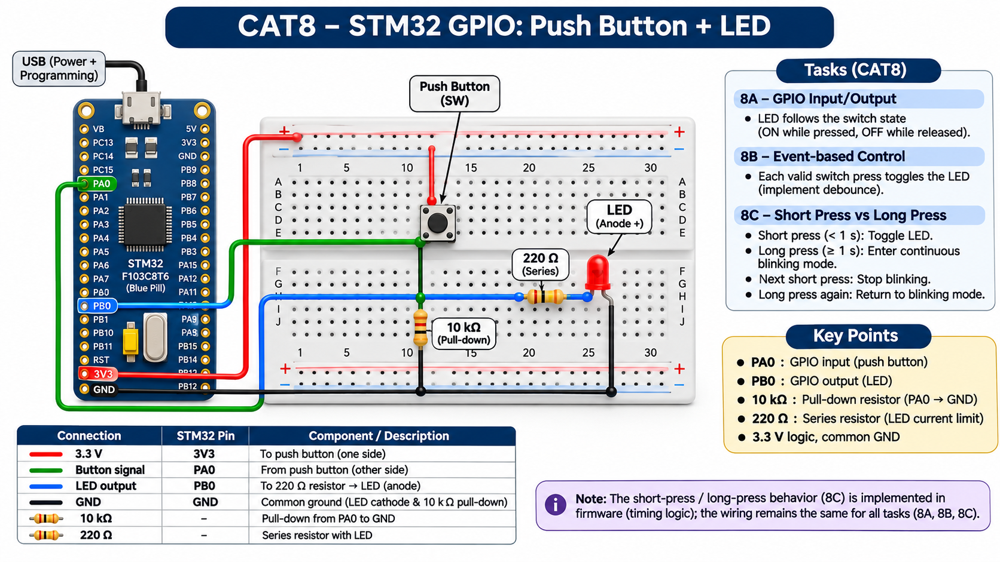

EXPERIMENT DETAILS
EXP: CONTINUOUS ASSESMENT 8
DATE: 18/09/2026
NAME OF EXP: STM32 GPIO Bring-Up and Switch-Controlled LED
HARDWARE SETUP / PLATFORM: custom board + STM32F103C(8-B)Tx + PA9 input pull-up; PC13 LED output + STM32CubeMX (MDK-ARM project)
TASK 8B : Event-Based Control

1. Circuit Diagram
The diagram shows the task pins, clock source and required external connections.
* Microcontroller / Board: STM32F103C8Tx board (board name not recorded); MCU STM32F103C(8-B)Tx.
* GPIO / Peripheral pins: PA9 input pull-up; PC13 LED output.
* Clock: HSE through PLL, 72 MHz SYSCLK.
* External components: LED and series resistor on PC13, plus a push button on PA9 with internal pull-up.
* Power Supply: 3.3 V logic supply and common GND.

2. Core Logic / Pseudocode / Code Base
Working Principle: The program samples PA9 and waits for a stable 20 ms state before accepting a press. A valid press toggles PC13 once.
Pseudocode:
1. Sample PA9 and record candidate transitions with HAL_GetTick.
2. After 20 ms stable, toggle PC13 once on the press event.
Code Base: Embedded C using STM32 HAL (STM32CubeMX)
* HAL_GPIO_ReadPin samples PA9.
* HAL_GetTick measures debounce time.
* HAL_GPIO_TogglePin changes PC13 once per accepted press.

3. Inference
The program samples PA9 and waits for a stable 20 ms state before accepting a press. A valid press toggles PC13 once. The experiment demonstrates GPIO input, output and time-based switch handling.
