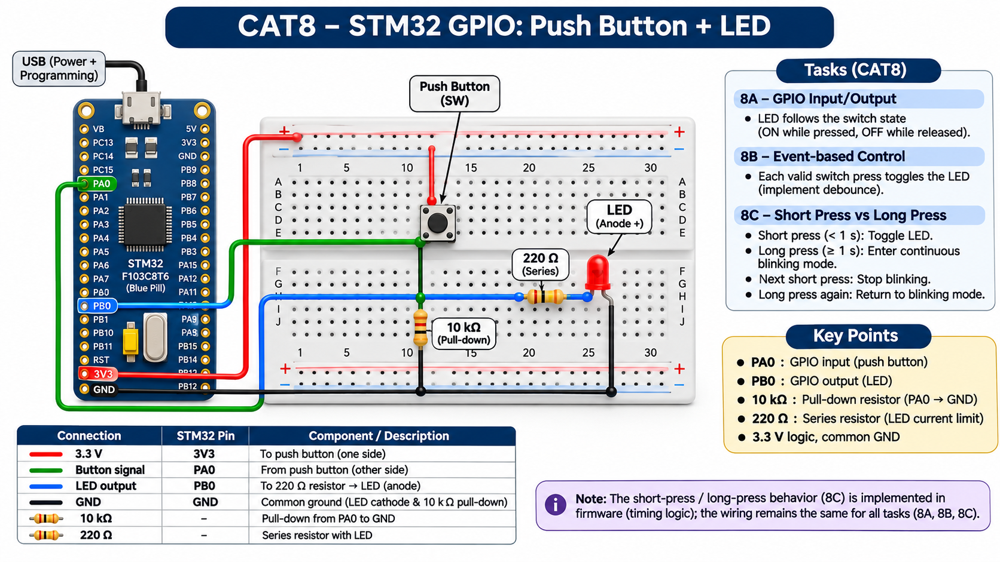

EXPERIMENT DETAILS
EXP: CONTINUOUS ASSESMENT 8
DATE: 18/09/2026
NAME OF EXP: STM32 GPIO Bring-Up and Switch-Controlled LED
HARDWARE SETUP / PLATFORM: custom board + STM32F103C(8-B)Tx + PA9 input pull-up; PC13 LED output + STM32CubeMX (MDK-ARM project)
TASK 8C : Short Press vs Long Press

1. Circuit Diagram
The diagram shows the task pins, clock source and required external connections.
* Microcontroller / Board: STM32F103C8Tx board (board name not recorded); MCU STM32F103C(8-B)Tx.
* GPIO / Peripheral pins: PA9 input pull-up; PC13 LED output.
* Clock: HSE through PLL, 72 MHz SYSCLK.
* External components: LED and series resistor on PC13, plus a push button on PA9 with internal pull-up.
* Power Supply: 3.3 V logic supply and common GND.

2. Core Logic / Pseudocode / Code Base
Working Principle: The button state is debounced without a blocking release loop. A short press toggles the LED, while a hold of at least one second changes blinking mode.
Pseudocode:
1. Debounce PA9 without waiting in a loop.
2. If released before 1 second, toggle PC13.
3. At 1 second while held, toggle blink mode; blink at 500 ms intervals while enabled.
Code Base: Embedded C using STM32 HAL (STM32CubeMX)
* HAL_GPIO_ReadPin samples PA9.
* HAL_GetTick checks debounce, press duration and blink intervals.
* HAL_GPIO_TogglePin toggles PC13 and generates the blink.

3. Inference
The button state is debounced without a blocking release loop. A short press toggles the LED, while a hold of at least one second changes blinking mode. The experiment demonstrates GPIO input, output and time-based switch handling.

