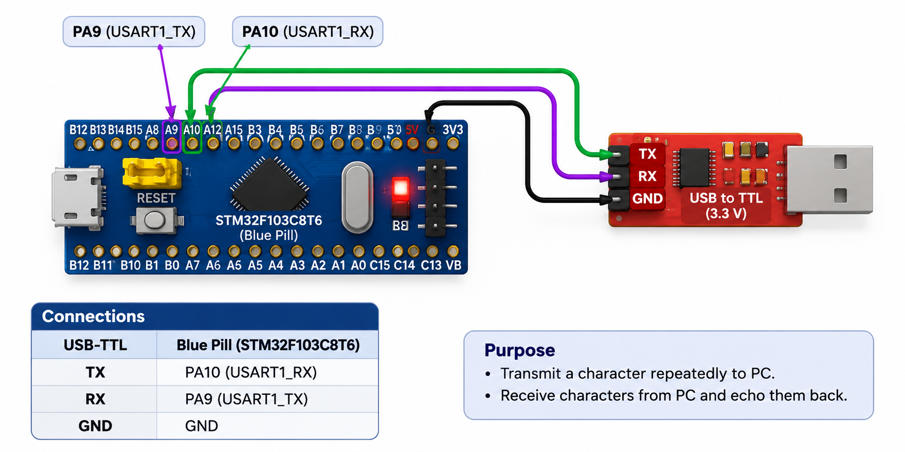

# CAT9 – Task 9A: Basic UART Communication

## EXP
CAT9

## DATE
28/09/2026

## NAME OF EXP
STM32 UART Command Controlled LED

## HARDWARE SETUP / PLATFORM
- STM32 Blue Pill (STM32F103C8T6)
- USB-to-TTL serial adapter
- PC terminal (PuTTY)
- USART1 TX: PA9
- USART1 RX: PA10
- Baud rate: 115200
- System clock: 72 MHz

## TASK NO
Task 9A – Basic UART Communication

## Circuit Diagram

## Core Logic / Pseudocode / Code Base

1. Configure USART1 in asynchronous mode.
2. Initialize UART using `HAL_UART_Init()`.
3. Transmit a character repeatedly to the PC terminal using `HAL_UART_Transmit()`.
4. Receive characters from the PC using `HAL_UART_Receive()`.
5. Echo every received character back to the terminal.

Source code: `Core/Src/main.c`

## INFERENCE
Established serial communication between the STM32 Blue Pill and a PC terminal using USART1 and STM32 HAL APIs. Character transmission and reception with echo functionality were implemented successfully. The Keil project compiled without errors.