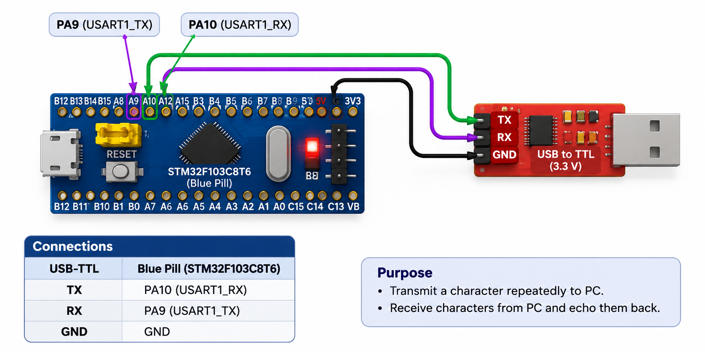

# CAT9 – Task 9B: String-Based Application Logic

## EXP
CAT9

## DATE
28/09/2026

## NAME OF EXP
STM32 UART Command Controlled LED

## HARDWARE SETUP / PLATFORM
- STM32 Blue Pill (STM32F103C8T6)
- USB-to-TTL serial adapter
- PC terminal (PuTTY)
- USART1 TX: PA9
- USART1 RX: PA10
- Onboard LED: PC13
- Baud rate: 115200

## TASK NO
Task 9B – String-Based Application Logic

## Circuit Diagram

## Core Logic / Pseudocode / Code Base

1. Initialize USART1 for serial communication.
2. Receive characters from the PC terminal.
3. Store incoming characters in a command buffer.
4. Detect the end of a command using carriage return or newline.
5. Compare the received string against supported commands:
   - `LED ON` – Turn ON the onboard LED.
   - `LED OFF` – Turn OFF the onboard LED.
   - `LED TOGGLE` – Toggle the onboard LED.
6. Transmit a confirmation or invalid-command response to the terminal.

Source code: `Core/Src/main.c`

## INFERENCE
Implemented string-based UART command processing using STM32 HAL. The onboard LED is controlled through serial commands received from a PC terminal. The project compiled successfully using Keil MDK-ARM.